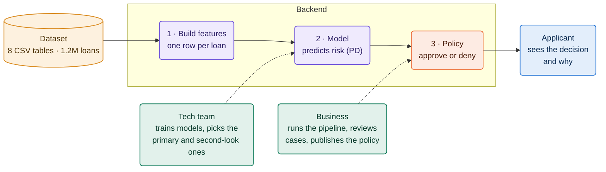
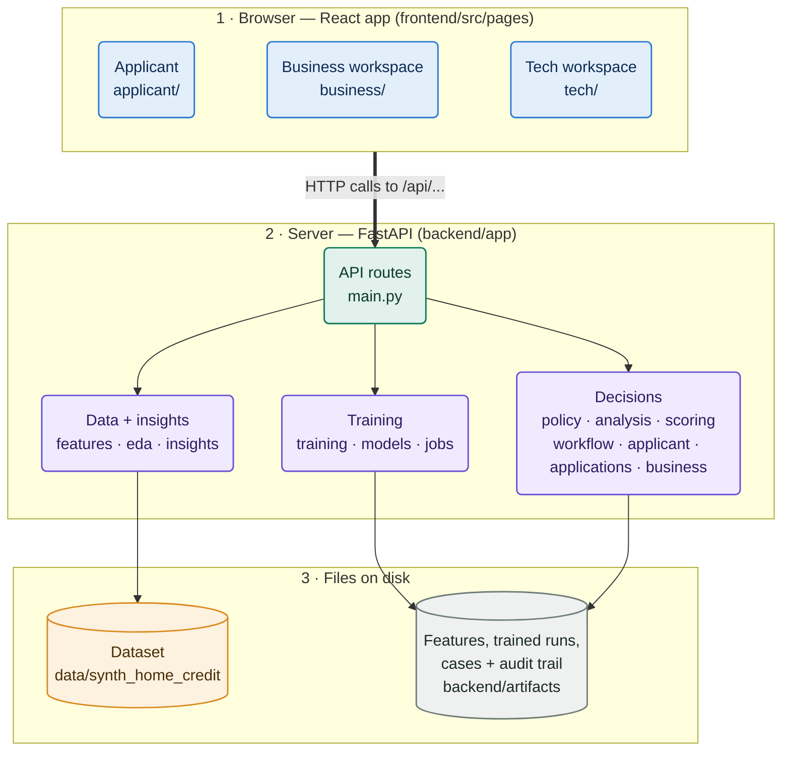
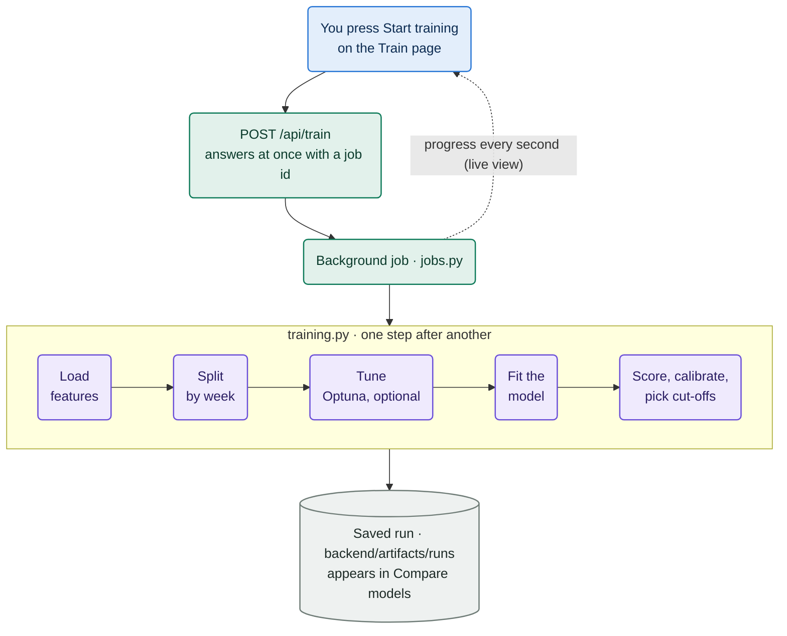
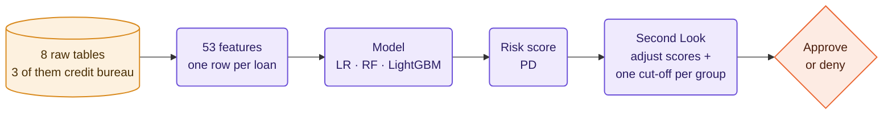
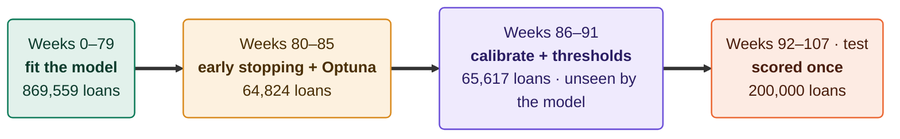
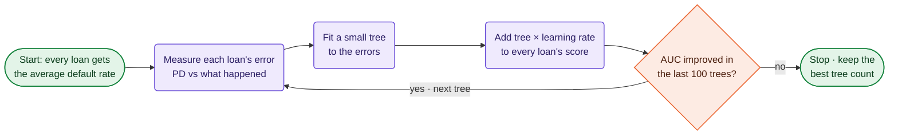
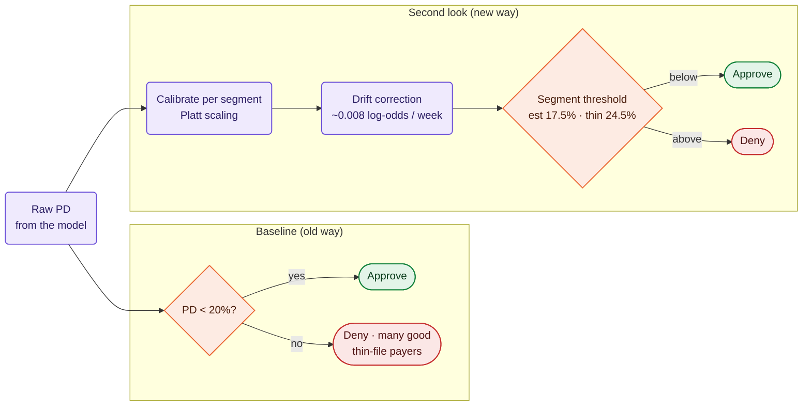
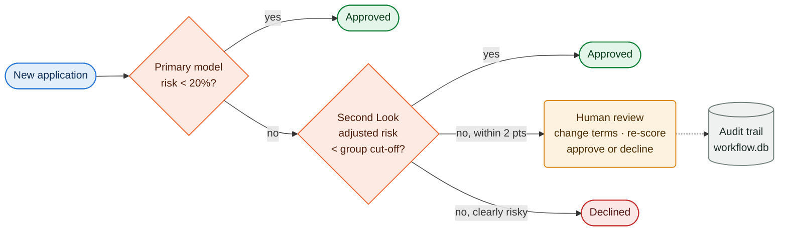

<div align="center">

<sub>BREAK THROUGH TECH AI · AI STUDIO CHALLENGE 2026</sub>

# 🏦 Second-Look Lending — Project Guide

**Predict each applicant's probability of default, turn it into an approve / deny decision that makes money,
and give applicants with little credit history a fair second look.**

</div>

This guide is for anyone joining the project: what it does, how it is built, how to run it, how to use every page,
and where to start reading the code. The same guide, with a side menu and dark mode, is in
[`PROJECT_GUIDE.html`](PROJECT_GUIDE.html) (also served by the app at `http://localhost:8000/guide`).

### 📑 Contents

| | | |
|---|---|---|
| 1. [What this project is](#overview) | 5. [How training works](#training) | 9. [Code walkthrough](#code) |
| 2. [Results](#results) | 6. [The decision policy](#policy) | 10. [API reference](#api) |
| 3. [Architecture](#architecture) | 7. [Setup guide](#setup) | 11. [Troubleshooting](#troubleshooting) |
| 4. [ML pipeline](#pipeline) | 8. [How to use the app](#use) | 12. [Glossary](#glossary) |

---

<a id="overview"></a>

## 🎯 1. What this project is

A lender has a cost model: a repaid loan earns **+$2,000**, a default loses **−$8,000**, a denied applicant is $0.
So approving only pays off when the probability of default (PD) is below **2,000 / (2,000 + 8,000) = 20%**.

The catch is **thin-file applicants**: people with no credit-bureau history (30% of applicants). The model knows less
about them, and in this data their risk falls over time, so a model trained on older weeks thinks they are riskier
than they are. A flat 20% rule then turns away many who would have repaid. The project measures that unfairness (the
**inclusion gap**) and fixes it without losing profit.

| Train loans | Test loans (later weeks) | Default rate | Thin-file applicants |
|:---:|:---:|:---:|:---:|
| **1,000,000**<br/><sub>weeks 0–91</sub> | **200,000**<br/><sub>weeks 92–107</sub> | **19.2%**<br/><sub>imbalanced target</sub> | **30%**<br/><sub>no bureau contracts</sub> |

The dataset is **synthetic** — it mimics a real credit bureau's tables but contains no real people.

---

<a id="results"></a>

## 📈 2. Results

Out-of-time test set, scored once against the answer key. The model and every setting were chosen on validation
weeks only.

| Model | Test AUC | LogLoss | Baseline → second-look profit | Inclusion gap |
|---|---:|---:|---:|---:|
| Logistic Regression (baseline) | 0.7595 | 0.3914 | $144.4M → $151.5M | 38.4 → −1.9 pts |
| Random Forest | 0.7613 | 0.3898 | $141.0M → $152.7M | 47.9 → −1.8 pts |
| LightGBM | 0.7674 | 0.3863 | $147.6M → $154.1M | 36.0 → −0.3 pts |
| **⭐ LightGBM + Optuna (chosen)** | **0.7676** | **0.3862** | **$147.7M → $153.2M** | **36.9 → −5.4 pts** |

Every model earns **more** and becomes **fairer** with the second-look policy. Of thin-file applicants who repaid,
80.6% are approved instead of 41.2%. Most of the gain comes from calibration: thin-file PDs go from 25.9% (raw) to
18.0%, against a real default rate of 17.8%.

> [!NOTE]
> These numbers are for Second Look deciding **every** application. In the app's pipeline Second Look only looks again
> at the primary model's declines, which gives **$147.7M → $154.0M** and a gap of **36.9 → −2.5 pts**.

---

<a id="architecture"></a>

## 🏗️ 3. Architecture

### The big picture

Data goes in on the left, a decision comes out on the right. The tech team controls the model, the business controls
the policy, and the applicant sees the result.



### System architecture: three layers

Read it top to bottom. The **browser** shows the three workspaces and only talks to the server through `/api` calls.
The **server** has four groups of Python files. The **disk** holds the read-only dataset and everything the app saves.



### What happens when you press "Start training"



---

<a id="pipeline"></a>

## 🔬 4. ML pipeline

From eight raw tables to an approve / deny decision. The model never sees the raw tables; it sees one row of 53
features per loan.



**Thin-file flag:** an applicant with zero rows in `credit_bureau_a_1`. Those people also miss `static_cb_0` and
`credit_bureau_a_2`, so every bureau feature is empty for them.

### The time split



Lending always predicts the future from the past, so we split by week, never at random. Each window has one job, so
nothing is judged on data it was tuned on. The Data overview page shows this flow with live row counts, and lets you
browse every raw table and the feature table the model trains on.

---

<a id="training"></a>

## 🧠 5. How training works

Three algorithms, from simplest to strongest. Each one outputs a PD between 0 and 1.

| Model | Idea in one line | "Epochs"? |
|---|---|---|
| Logistic Regression | One weight per feature, add them up, squash into a probability. | `max_iter`: each solver iteration is one pass over all loans (stopped after 67). |
| Random Forest | Hundreds of independent decision trees on random samples, averaged. | None — every tree is built once. |
| LightGBM | Trees built one after another, each fixing the mistakes left by the previous ones. | Boosting rounds: one tree per round, stopped early by validation AUC. |

### The LightGBM training loop



The Train page shows this live: each step, every Optuna trial as it finishes, and the learning curve growing tree by
tree. Insights → Model draws the trained model's real first tree.

---

<a id="policy"></a>

## ⚖️ 6. The decision policy



- **Inclusion gap** = among applicants who actually repaid, approval rate of established minus thin-file.
- **Inclusive Profit Score** = profit − penalty × |gap|, counted only if the default rate of approved loans stays
  under 12%. Penalty: $100,000 per gap point per 100k applicants.
- Thresholds are searched on weeks 86–91 (every pair from 5% to 50%) and the best score wins.

### The decision pipeline: primary → Second Look → a person

In the app the two run one after the other. The **primary model** decides first with one 20% cut-off. Only its
declines go to **Second Look** — automatically, or when a business user sends them (Work queue → Manual). Second Look
declines that are close to the cut-off wait for a **person**.



- **Review band** (2 points by default) decides how close counts as borderline — about 260 cases a week.
- A reviewer can approve against the model (an **override**) only with a written reason. Every step, who did it and
  the terms they changed go into the audit trail.
- The primary and second-look models are chosen by the tech team on *Compare models*; until then both use the run
  with the best validation AUC. Settings live in `workflow_settings.json` and `model_roles.json`.
- **Online applications** enter here too. `applications.py` starts from a typical recent applicant in the same
  credit-history group and puts the applicant's answers on top, so the models get a full feature row. Name and email
  stay in the local `workflow.db` and never reach the models.

---

<a id="setup"></a>

## 🛠️ 7. Setup guide

**You need:** Python 3.9+, Node.js 18+, git, and the dataset folder `synth_home_credit` (containing `csv_files/` and
`solution.csv`). No GPU, no accounts. Python comes from [python.org](https://www.python.org/downloads/) (on Windows
tick *Add python.exe to PATH*); Node.js is below.

### Install Node.js (once)

Node.js runs the web app's build tools; `npm` comes with it. Install the **LTS** version (18 or newer).

| System | Easiest way | Or from the command line |
|---|---|---|
| **macOS** | Download the macOS installer (`.pkg`) from [nodejs.org](https://nodejs.org) and run it | `brew install node` (needs [Homebrew](https://brew.sh)) |
| **Windows** | Download the Windows installer (`.msi`) from [nodejs.org](https://nodejs.org) and run it, keeping *Add to PATH* ticked | `winget install OpenJS.NodeJS.LTS` |
| **Linux** | Your package manager (e.g. `sudo apt install nodejs npm`), if it offers 18+ | [nvm](https://github.com/nvm-sh/nvm): `nvm install --lts` |

Then **open a new Terminal / Command Prompt** (so it finds Node) and check:

```bash
node --version    # v18 or newer
npm --version
```

No admin rights on your Mac? Download the macOS *binary* (`.tar.gz`) from nodejs.org, unpack it into your home
folder (for example `~/.local/node`), and add `export PATH="$HOME/.local/node/bin:$PATH"` to `~/.zshrc`.

> [!TIP]
> **Quick start.** After steps 1 and 2 below, one script does the rest.
>
> | | macOS / Linux (Terminal) | Windows (Command Prompt, or double-click) |
> |---|---|---|
> | Install once | `./setup.sh` | `setup.bat` |
> | Start the app | `./start.sh` | `start.bat` |
> | Live-reloading UI on :5173 | `./start.sh --dev` | `start.bat --dev` |
>
> Then open **http://localhost:8000**. The scripts check Python and Node, install everything, build the UI, check the
> dataset and are safe to re-run. Windows needs the Microsoft Visual C++ Redistributable (x64) for LightGBM.

Prefer to do it by hand? The manual steps:

1. **Get the code**
   ```bash
   git clone https://github.com/Break-Through-Tech/American-Express-1C-second-look-lending.git
   cd American-Express-1C-second-look-lending
   ```
2. **Add the dataset** — put (or unzip) it at `data/synth_home_credit/`, so that `data/synth_home_credit/csv_files/`
   exists. The app reads it from there; there is nothing to configure. The folder is git-ignored, so the data is never
   committed.
3. **Install and start the backend**
   ```bash
   cd backend
   python3 -m venv .venv
   .venv/bin/pip install -r requirements.txt
   scripts/fix_lightgbm_macos.sh        # macOS only, if Homebrew's libomp is missing
   .venv/bin/uvicorn app.main:app --port 8000 --reload
   ```
   Check it: http://localhost:8000/api/health should say `"data_found": true`. Interactive API docs: http://localhost:8000/docs.
4. **Install and start the frontend** (second terminal)
   ```bash
   cd frontend
   npm install
   npm run dev                          # open http://localhost:5173
   ```
   Or build once with `npm run build` and use http://localhost:8000 — FastAPI serves the built app.
5. **Train your first models** — on the Train page, train Logistic Regression, then Random Forest, then LightGBM. The
   first request builds the feature tables (about 20 seconds) and caches them. Each model takes 5–20 seconds; LightGBM
   with 20 Optuna trials about a minute.

> [!TIP]
> **Prefer the terminal?** `.venv/bin/python -m app.cli --model lightgbm --trials 20` trains a run without the UI.
> The notebook `notebooks/second_look_lending.ipynb` runs the whole project on free Colab.

---

<a id="use"></a>

## 🖥️ 8. How to use the app

The app has three workspaces — pick one on the home page or with the switcher at the top. **Help** (top right) has
the project overview, how-to guides, a glossary and FAQs.

<table>
<tr>
<td width="50%" valign="top">

### 👤 Applicant
`/apply` · `/apply/status` · `/apply/1000005`

For people applying for a loan. A five-step form (loan, about you, income & work, credit history, review & submit)
gives an instant decision and an application number; *Check your status* finds it again. Tick **Use a simulated
customer** to pre-fill every step with made-up details. The decision comes first, then plain-language reasons (*what
helped*, *what held it back*), a loan-amount slider for what-if, and next steps. No risk scores or jargon.
"Approved through Second Look" appears when the second look made the difference.

</td>
<td width="50%" valign="top">

### 💼 Business
`/business/pipeline` · `/business` · `/business/statistics` · `/business/policy`

**Work queue** (opens first): process a week, send declines to Second Look (automatic or manual), open a borderline
case, change terms, re-score and decide; the *Online applications* tab lists every application submitted on Apply
with its decision. **Dashboard**: profit, approval rate, default rate and inclusion gap, primary model only vs with
Second Look. **Statistics**: how many the primary model approved or declined, how many went through Second Look and
how many wait for a person, with charts. **Policy lab**: *Preview* a policy change safely; *Publish* makes it live.

</td>
</tr>
<tr>
<td valign="top">

### 🧪 Tech team
`/tech` · `/tech/insights` · `/tech/train` · `/tech/models`

**Data overview**: the data flow (8 raw tables → feature table → split by week) and the training data itself —
browse every raw table and the feature table, filter, and follow one loan across tables. **Insights**: how features
are built and how models work. **Train models**: settings with ⓘ tooltips and a live training view. **Compare
models**: compare on validation, then *Set as primary* or *Set as second look*.

</td>
<td valign="top">

### ❓ Help
`/help`

Project overview, how the workspaces connect, step-by-step guides for each role, how decisions are made, a glossary,
FAQs and links to this guide and the API docs.

</td>
</tr>
</table>

> [!IMPORTANT]
> **Golden rule:** make every choice (model, settings, policy) on validation. Look at the test numbers once, at the
> end. Picking by test score quietly turns the test set into training data.

---

<a id="code"></a>

## 📂 9. Code walkthrough

The backend is plain Python functions with one-line comments; the frontend is plain React with one file per page.
Read in this order:

1. **`backend/app/config.py`** — paths, the cost model, the week split. 30 lines.
2. **`backend/app/features.py`** — how 8 tables become 53 features. One small function per table.
3. **`backend/app/models.py`** — `PDModel` wraps preprocessing and model for all three algorithms; `fit()` and
   `predict_pd()` are the core.
4. **`backend/app/training.py`** — `train()` ties it together: split, tune, fit, score, save.
5. **`backend/app/policy.py`** — the money maths: calibration, drift, profit, gap, threshold search.
6. **`backend/app/main.py`** — every API route in one file; each route is a few lines.
7. **`frontend/src/api.js`**, then **`App.jsx`** (routes) and **`components/Layout.jsx`** (header and workspaces),
   then **`pages/`** — one folder per workspace: `applicant/`, `business/`, `tech/`.

### Every backend file

| File | Job |
|---|---|
| `config.py` | Paths, cost model, week split |
| `features.py` | Read CSVs, aggregate, build and cache the feature table, thin-file flag |
| `models.py` | The three models (preprocessing + estimator), Optuna search space |
| `param_help.py` | Plain-English help for every hyperparameter (shown as tooltips) |
| `training.py` | One training run end to end, with live progress |
| `jobs.py` | Background thread that runs training jobs |
| `policy.py` | Metrics, calibration, drift, profit, inclusion gap, threshold search |
| `analysis.py` | Compares the four policies for a run and saves the result |
| `storage.py` | Save, list, load and delete runs; which run is the primary / second-look model |
| `scoring.py` | Pipeline settings, and the primary and Second Look scores for every test application |
| `workflow.py` | The decision pipeline: process a week, send to Second Look, human review, audit trail (SQLite) |
| `eda.py` | Numbers for the Data overview page: windows, training-data and raw-table pages |
| `insights.py`, `algorithm.py`, `feature_info.py` | Numbers and descriptions for the Insights page |
| `applicant.py` | Score one applicant with what-if changes |
| `applications.py` | Online applications: save the form and turn it into one feature row for the models |
| `business.py` | Business dashboard numbers: primary model only vs with Second Look, on the recent weeks |
| `main.py`, `cli.py` | API routes and the command-line trainer |

### Common changes

<table>
<tr>
<td width="50%" valign="top">

**➕ Add a feature**

Add a column in `features.py` (inside the table's aggregation function, or in `add_derived_features`). Delete
`backend/artifacts/features/` or call `POST /api/features/build`, retrain, then run
`scripts/make_data_dictionary.py`.

</td>
<td width="50%" valign="top">

**➕ Add a model**

Add it to `MODEL_NAMES` and `DEFAULT_PARAMS` in `models.py`, build it in `build_model()`, give it a search space in
`suggest_params()` and help text in `param_help.py`. The UI picks it up automatically.

</td>
</tr>
</table>

---

<a id="api"></a>

## 🔌 10. API reference

Interactive docs with a "Try it out" button: http://localhost:8000/docs

| Method | Path | What it does |
|---|---|---|
| GET | `/api/health` | Is the dataset found, are features built |
| POST | `/api/features/build` | Rebuild the feature tables (background job) |
| GET | `/api/eda/overview`, `/api/eda/feature/{name}` | Overview numbers (including the week windows), default rate by bin |
| GET | `/api/eda/training-sample`, `/api/eda/raw-table/{name}` | Pages of the training feature table (filter by window, segment, outcome) and of each raw table (optionally one loan) |
| GET | `/api/models` | Model types, defaults, parameter help |
| POST | `/api/train` | Start training: `model_type`, `params`, `sample_fraction`, `tune_trials`, weeks |
| GET | `/api/jobs`, `/api/jobs/{id}` | Job list, or one job with logs and live progress |
| GET / DELETE | `/api/runs`, `/api/runs/{id}` | Trained runs and their metrics; delete a run |
| GET / POST | `/api/runs/{id}/policy` | Get the published policy, or run it with new options (`save: false` = preview, `true` = publish) |
| GET / PUT | `/api/model-roles` | Which runs are the primary and second-look models; set one (`role`, `run_id`) |
| GET / PUT | `/api/workflow/settings` | Pipeline settings: `mode` (auto / manual), `primary_cutoff`, `review_band` |
| GET | `/api/workflow/summary` | Counts per status and per week, review progress, repaid share per route |
| POST | `/api/workflow/process` | Run the primary model on one week (92–107) |
| POST | `/api/workflow/second-look` | Send primary declines to Second Look (chosen `case_ids`, or all waiting) |
| GET | `/api/workflow/cases`, `/api/workflow/cases/{id}` | Cases by status (`online=true`: online applications, newest first); one case with scores, reasons and audit trail |
| POST | `/api/workflow/cases/{id}/rescore`, `/decide` | Re-score with changed terms; approve or decline (override needs a `reason`) |
| POST | `/api/workflow/reset` | Clear all cases and start over |
| GET | `/api/business/dashboard` | Business dashboard numbers: primary model only vs with Second Look |
| POST | `/api/portal/apply` | Submit an online application; it goes through the pipeline straight away |
| GET / POST | `/api/portal/showcase`, `/api/portal/score` | Applicant portal: example applications, and one decision with what-if changes |
| GET | `/api/insights/raw`, `/api/runs/{id}/insights`, `/api/runs/{id}/algorithm` | Insights page data |

---

<a id="troubleshooting"></a>

## 🩺 11. Troubleshooting

| Problem | Fix |
|---|---|
| `Library not loaded: libomp.dylib` (macOS) | Run `backend/scripts/fix_lightgbm_macos.sh`, or `brew install libomp`. |
| LightGBM won't load on Windows | Install the Microsoft Visual C++ Redistributable (x64), then run `setup.bat` again. |
| `"data_found": false` | Put the dataset in `data/synth_home_credit` (with `csv_files/` inside), then restart the backend. |
| Port 8000 or 5173 already in use | Stop the old server, or start with another `--port` (update `vite.config.js` to match). |
| "Run … not found" on a page | The run was deleted; pick another run, or train a new one. |
| Feature changes don't show up | Delete `backend/artifacts/features/` (or call `POST /api/features/build`) and retrain. |

---

<a id="glossary"></a>

## 📖 12. Glossary

| Term | Meaning |
|---|---|
| **PD** | Probability of default: the model's estimate that a loan won't be repaid. |
| **Thin-file** | An applicant with no credit-bureau history. |
| **AUC** | How well the model ranks people: 0.5 is guessing, 1 is perfect. |
| **LogLoss / Brier** | How far PDs are from what happened. Lower is better. |
| **Calibration** | Whether a PD of 20% really means 20 in 100 default. |
| **Drift** | Data changing over time; here thin-file risk falls week by week. |
| **Early stopping** | Stop adding trees once validation stops improving. |
| **Epoch** | A full pass over the data. Not used by these models; see section 5. |
| **Inclusion gap** | Approval rate among repayers: established minus thin-file. |
| **Out-of-time test** | Later weeks the model never trained on, scored once at the end. |
