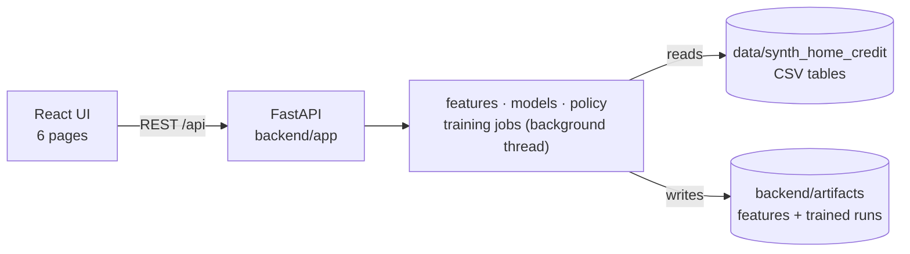
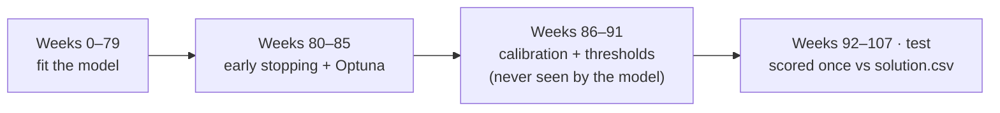

# Second-Look Lending

**Profit-aware, inclusive credit decisions.** Predict each applicant's probability of default (PD), turn it into an
approve / deny decision that makes money, and give applicants with little credit history ("thin-file") a fair second look.

Break Through Tech AI · AI Studio Challenge 2026 (Aug – Dec 2026).

> 📘 New to the project? Open **[PROJECT_GUIDE.html](PROJECT_GUIDE.html)** in a browser: it has the architecture and
> training-flow diagrams, a setup guide, a tour of every page and a code walkthrough.

---

### 👥 **Team Members**

| Name | GitHub Handle | Contribution |
|------|---------------|--------------|
| _add your name_ | _@handle_ | _what you worked on_ |

---

## 🎯 **Project Highlights**

- Built a **web app** (React + FastAPI) that trains, compares and explains three PD models — logistic regression,
  random forest and LightGBM — on a 1M-loan synthetic credit-bureau dataset.
- Found the **inclusion trap**: thin-file default risk falls over time, so a model trained on older weeks over-estimates
  thin-file risk on newer applicants (25.9% predicted vs 17.8% actual) and a flat "approve if PD < 20%" rule denies good payers.
- Designed a **second-look policy** — per-segment calibration, a drift correction and per-segment thresholds — that
  **raised test profit from $147.7M to $153.2M and closed the inclusion gap from 36.9 to −5.4 points**.
- Kept the method honest: time-based splits, policy tuned on weeks the model never saw, and the test set scored once.
- Made it **teachable**: a guided Insights page explains the raw data, the algorithm (its real first tree), the training
  loop and every decision in plain English, and the Train page shows training live.

---

## 👩🏽‍💻 **Setup and Installation**

**You need:** Python 3.9+, Node.js 18+, and the synthetic dataset folder (`synth_home_credit`, with `csv_files/` and
`solution.csv` inside). No GPU and no accounts are needed.

```bash
# 1. Clone the repository
git clone https://github.com/Break-Through-Tech/American-Express-1C-second-look-lending.git
cd American-Express-1C-second-look-lending

# 2. Put the dataset in data/synth_home_credit (git-ignored; never commit data)
#    or keep it anywhere and run:  export SLL_DATA_DIR=/path/to/synth_home_credit

# 3. Backend
cd backend
python3 -m venv .venv
.venv/bin/pip install -r requirements.txt
scripts/fix_lightgbm_macos.sh            # macOS only, if Homebrew's libomp is not installed
.venv/bin/uvicorn app.main:app --port 8000 --reload

# 4. Frontend (second terminal)
cd frontend
npm install
npm run dev                              # open http://localhost:5173
```

Prefer one server? Run `npm run build` once in `frontend/`, then open **http://localhost:8000** — FastAPI serves the
built UI. The first request builds the feature tables (about 20 seconds) and caches them in `backend/artifacts/`.

**Without the UI:**

```bash
cd backend
.venv/bin/python -m app.cli --model logreg
.venv/bin/python -m app.cli --model random_forest --sample 0.5
.venv/bin/python -m app.cli --model lightgbm --trials 20        # with Optuna tuning
```

**Notebook:** `notebooks/second_look_lending.ipynb` runs end to end on free Google Colab (put the dataset in
`MyDrive/synth_home_credit`) or locally — EDA, all three models and the policy, in about 3 minutes.

---

## 🏗️ **Project Overview**

Lenders serving people with little or no credit history face a trap: cautious models deny these applicants even when
they would repay, losing good customers and shutting out the underserved. This project answers two questions:

1. **Prediction** — "Will this person repay?" → a probability of default (PD).
2. **Decision** — "Given that PD, do I approve, and am I fair to newcomers?" → an approve / deny policy.

**Economics (from the brief):** a repaid loan earns **+$2,000**, a default costs **−$8,000**, a denial is $0. Approving
pays off only when `(1 − PD) × 2,000 − PD × 8,000 > 0`, i.e. **PD < 20%**.

**Success criteria:** a PD model that beats a logistic-regression baseline (AUC, LogLoss); a policy that beats a naïve
baseline on profit; a measurable reduction in the thin-file inclusion gap; reproducible code, notebook and report.



---

## 📊 **Data Exploration**

- **Dataset:** a synthetic stand-in for the Kaggle *Home Credit – Credit Risk Model Stability* data. 1,000,000 train
  loans (weeks 0–91) and 200,000 out-of-time test loans (weeks 92–107), in 8 relational tables joined by `case_id`.
  It contains no real people.
- **Structure:** depth-0 tables have one row per loan and join directly; depth-1/2 tables (credit bureau contracts,
  monthly payments, prior applications, tax records, people) have many rows per loan and are aggregated first
  (count / mean / max / sum / category shares) into **53 features**. See [`doc/DATA_DICTIONARY.md`](doc/DATA_DICTIONARY.md).
- **Target:** 19.2% of train loans default — imbalanced, so we use AUC / LogLoss / Brier, not accuracy.
- **Thin-file segment:** applicants with no `credit_bureau_a_1` rows — **30%** of loans. They default more on average
  (25.6% vs 16.4%) but their risk **falls week by week** (≈33% → 19%) while established risk stays flat.
- **Data quality:** no duplicate rows, constant columns, `365243` sentinels or leakage (no future-dated records, no
  shared applicants between train and test). Missing values come almost entirely from thin-file applicants having no
  bureau data, so they are kept, not dropped. Amounts are right-skewed (log-transformed and clipped for the linear model).

The full written EDA (distributions, correlations, categories, signal per segment, leakage checks) is in the notebook;
the app's **Overview** and **Insights → Raw data** pages show it interactively.

---

## 🧠 **Model Development**

| Model | Preprocessing | Notes |
|---|---|---|
| Logistic Regression (baseline) | clip outliers, median impute + missing flags, log1p, scale, one-hot | the bar to beat |
| Random Forest | ordinal-encoded categories, NaN handled natively | 200 trees on a 50% sample |
| LightGBM | none — native missing values and categories | early stopping; optional Optuna tuning |

**Split by time, never at random:**



- **Tuning:** Optuna (TPE), 20 trials on a 25% sample, one metric (model-validation AUC). `scale_pos_weight` is left
  out because it inflates PDs without improving ranking.
- **Second-look policy:** (1) Platt calibration fitted separately for thin-file and established; (2) a drift correction
  that moves each PD along its segment's weekly default-rate trend; (3) one threshold per segment, chosen on weeks
  86–91 to maximise the **Inclusive Profit Score** = profit − penalty × |gap| (only if the default rate of approved
  loans stays under 12%).

---

## 📈 **Results & Key Findings**

Out-of-time test set (200,000 loans), scored once. The model was chosen on validation AUC.

| Model | Test AUC | Test LogLoss | Baseline → second-look profit | Gap → second-look |
|---|---|---|---|---|
| Logistic Regression | 0.7595 | 0.3914 | $144.4M → $151.5M | 38.4 → −1.9 pts |
| Random Forest | 0.7613 | 0.3898 | $141.0M → $152.7M | 47.9 → −1.8 pts |
| LightGBM | 0.7674 | 0.3863 | $147.6M → $154.1M | 36.0 → −0.3 pts |
| **LightGBM + Optuna** | **0.7676** | **0.3862** | **$147.7M → $153.2M** | **36.9 → −5.4 pts** |

- LightGBM beats the logistic-regression baseline on AUC and LogLoss.
- Every model makes **more profit and closes the gap** with the second-look policy. Of thin-file applicants who repaid,
  80.6% are now approved instead of 41.2%.
- **Calibration does most of the work:** once thin-file PDs are honest (raw 25.9% → calibrated 18.0%, actual 17.8%),
  even the plain 20% rule is far fairer. Per-segment thresholds, tuned on only 6 weeks, are noisier and can overshoot
  past zero gap (a negative gap = thin-file payers approved slightly more often).

---

## 🚀 **Next Steps**

- The drift correction assumes the weekly trend continues in a straight line; in production it should be re-estimated
  as new outcomes arrive.
- Add bootstrap confidence intervals for profit and gap, and week-by-week AUC stability.
- Engineer more thin-file signals from internal data (prior-application history over time, income stability).
- Try CatBoost, and check the same gap metric across other groups (education, housing type).

---

## 📝 **License**

Not chosen yet — pick one with your Challenge Advisor (for example MIT) and add a `LICENSE` file.

---

## 📄 **References**

- Second-Look Lending challenge brief and dataset guide (AI Studio 2026)
- [scikit-learn user guide](https://scikit-learn.org/stable/user_guide.html) — pipelines, calibration, model selection
- [LightGBM documentation](https://lightgbm.readthedocs.io/) — gradient boosting on tabular data
- [Optuna documentation](https://optuna.readthedocs.io/) — hyperparameter optimisation
- Platt, J. (1999). *Probabilistic outputs for support vector machines* — Platt scaling

---

## 🙏 **Acknowledgements**

Thanks to our Challenge Advisor, AI Studio coach and the Break Through Tech AI team for their guidance.

---

### 📁 Where things are

| Path | What it is |
|---|---|
| `backend/app/` | FastAPI app and all ML code (features, models, training, policy, insights) |
| `frontend/src/` | React UI: Overview, Insights, Train, Compare, Policy lab, Score applicant |
| `notebooks/second_look_lending.ipynb` | Reproducible EDA + models + policy notebook (built from `build_notebook.py`) |
| `doc/ARCHITECTURE.md`, `doc/architecture.html` | Architecture and model design |
| `doc/DATA_DICTIONARY.md` | Every feature and raw column |
| `PROJECT_GUIDE.html` | Diagrams, setup, how to use, code walkthrough for new team members |
| `data/` | Where the dataset goes (git-ignored) |
